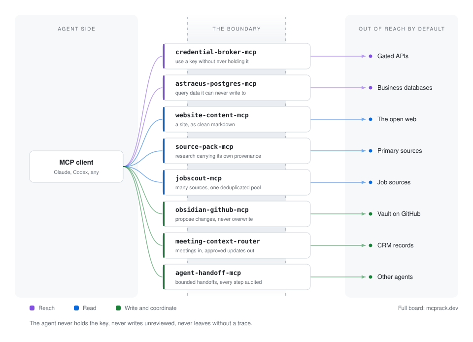
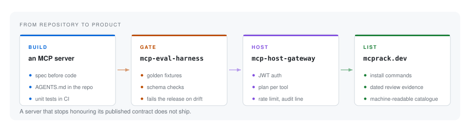

## Alexei Udall

**Seventeen years selling, and I ship the infrastructure too.** I work at the front of the business, in revenue and partnerships, and I build the tooling that makes that work repeatable. Most of what is here sits at the join between the two: agent infrastructure, knowledge systems, and the small tools that come out of doing the job.

Currently Head of Marketing at [Teneo Protocol](https://teneo-protocol.ai), a decentralised AI agent network.

- **[mcprack.dev](https://mcprack.dev)**: every MCP server I have published on one board, with install commands, plus the servers I actually run alongside them.
- **[alexeiudall.com](https://alexeiudall.com)**: career evidence, case studies, writing, projects, and a public read-only recruiter MCP.

<picture>
  <source media="(prefers-color-scheme: dark)" srcset="assets/boundary-dark.svg">
  
</picture>

---

### What I build

**Agent infrastructure.** Model Context Protocol servers, mostly TypeScript, all built around one idea: an agent should be able to do the job without being handed the keys to everything.

**Hosting and quality around them.** A gateway that puts auth, plans and rate limits in front of an MCP, and a shared harness that blocks a release if a server stops honouring its published contract.

**Knowledge systems.** Obsidian-centred vaults that agents can read from and propose into, without being able to quietly rewrite the source of truth.

**Games.** Small ones, mostly to learn. Phaser, Godot, pygame, and an older Unity one.

---

### MCP servers

Each one solves a boundary problem: what the agent is allowed to reach, what it is allowed to see, and what it leaves behind. The full board, with install commands and registry status, is at **[mcprack.dev](https://mcprack.dev)**.

| Server | What it is |
|---|---|
| [**credential-broker-mcp**](https://github.com/SarutobiSasuke8/credential-broker-mcp) | Agents use gated APIs without ever holding the keys. Declarative policy, deny-by-default, secret injected at the last moment, content-free audit record. One decision function shared by the dry-run explainer and the live path, so what it reports and what it enforces cannot drift apart. |
| [**astraeus-postgres-mcp**](https://github.com/SarutobiSasuke8/astraeus-postgres-mcp) | Read-only Postgres for agents, through a policy layer instead of a connection string. Every query is parsed, checked against table and column allowlists, then regenerated from the validated syntax tree, so the text an agent sends is never executed. Row caps, PII masking, audit log. |
| [**agent-handoff-mcp**](https://github.com/SarutobiSasuke8/agent-handoff-mcp) | Local-first bounded, auditable handoffs between AI agents. Lifecycle state machine, actor-scoped transitions, depth caps. |
| [**obsidian-github-mcp**](https://github.com/SarutobiSasuke8/obsidian-github-mcp) | Permissioned gateway letting agents propose changes to a GitHub-hosted Obsidian vault. Path policy, content policy, audit log. |
| [**meeting-context-router**](https://github.com/SarutobiSasuke8/meeting-context-router) | Meeting tools in, reviewable proposals out. Fathom, Fireflies and Granola normalised into one record with provenance, and nothing reaches the CRM or the vault without an explicit approve and deliver. |
| [**jobscout-mcp**](https://github.com/SarutobiSasuke8/jobscout-mcp) | Privacy-first, bring-your-own-connections job discovery across multiple sources. Normalisation, deterministic deduplication, provenance. Stops at discovery: no CVs stored, no ranking, no applying. |
| [**source-pack-mcp**](https://github.com/SarutobiSasuke8/source-pack-mcp) | Structured research source packs. Facts, quotes, numbers, dates, primary links, and a coverage map showing which claims are consistent, contested, or isolated. |
| [**website-content-mcp**](https://github.com/SarutobiSasuke8/website-content-mcp) | A site's content in agent-readable form. Real DOM parsing to clean markdown, sitemap discovery, disk cache, respects `robots.txt`, rate-limited. |
| [**gimp-agent-mcp**](https://github.com/SarutobiSasuke8/gimp-agent-mcp) | The whole of GIMP 3 for an agent: every PDB procedure and GEGL filter, layered XCF output you can keep editing, one undo step per batch. On [PyPI](https://pypi.org/project/gimp-agent-mcp/) and in the official MCP registry. |

What "boundary" means in practice. This is the whole of an agent's authority in `credential-broker-mcp`, and there is no way to exceed it:

```yaml
agents:
  - id: researcher
    credentials: [github-readonly]   # the token itself never reaches the agent
    methods: [GET]
    allow: ["/repos/**"]
    deny:  ["/repos/*/*/keys"]       # deny always beats allow
    max_response_bytes: 262144
```

A request must clear every gate: identity enabled, credential granted, method granted, URL inside the credential's own base URL, no deny match, and an explicit allow match. Redirects are refused outright, because a redirect could point anywhere and the injected credential would follow it.

---

### Running MCPs as products

<picture>
  <source media="(prefers-color-scheme: dark)" srcset="assets/release-path-dark.svg">
  
</picture>

| Project | What it is |
|---|---|
| [**mcp-host-gateway**](https://github.com/SarutobiSasuke8/mcp-host-gateway) | Hosted MCP edge. Bearer JWT auth, plan-based entitlement down to the tool, prompt and resource, per-identity rate limits, streaming relay, and an audit line per call with no bodies or tokens. Fails closed at startup if anything in its config does not add up. |
| [**mcp-eval-harness**](https://github.com/SarutobiSasuke8/mcp-eval-harness) | Shared contract tests for MCP servers. Golden fixtures and JSON Schemas, run through the official client, with a CI exit code that gates publishing. One question: does this server still honour the contract we published? |
| [**mcp-dashboard**](https://github.com/SarutobiSasuke8/mcp-dashboard) | Cost against use for your MCP toolbox across Claude Code, Codex, Gemini CLI and Cursor: RAM, context tokens, startup time and real call counts, with working on/off switches. On [PyPI](https://pypi.org/project/mcp-dashboard/). |
| [**mcp-rack**](https://github.com/SarutobiSasuke8/mcp-rack) | The source for [mcprack.dev](https://mcprack.dev). Static, no build step, one data file. |

---

### Methodology and tooling

| Project | What it is |
|---|---|
| [**Meta-Agent-OS**](https://github.com/SarutobiSasuke8/Meta-Agent-OS) | A Markdown operating system for diagnosing, designing, costing, and operating multi-agent systems. Upstream of code, not a runtime. Ten specialist personas, ordered stages, human decision gates. Most multi-agent projects fail because the team builds before it diagnoses. |
| [**agentops-template**](https://github.com/SarutobiSasuke8/agentops-template) | Governed, repo-native operating layer for AI-assisted development. Cross-agent contracts, permission gates, durable state, persona councils, drift checks, and one canonical verification path. |
| [**obsidian-multi-brain**](https://github.com/SarutobiSasuke8/obsidian-multi-brain) | Local-first architecture for one canonical vault and governed downstream brains. Includes a validated mixed-authority bridge for public-safe agent context, bounded workspaces, and quarantined CRM proposals. |
| [**Prompt-Library**](https://github.com/SarutobiSasuke8/Prompt-Library) | Curated system prompts for building with AI. Static site, no build step. |

---

### How I work

I write the specification before the code, and I keep an `AGENTS.md` in every repository so that both humans and agents know the rules of the project. Public repositories carry an open licence, and their tests run in CI. I would rather ship something small that works than something broad that does not.

**Currently building**, as of October 2026: the layer that turns these servers into something other people can run and pay for. A hosted gateway in front of them, a shared contract harness gating every release, a governed read-only Postgres server for small-business installs, and a local control plane that tracks project stages, human decision gates and inference costs across every repository, with agents reporting into it over MCP.

---

### Elsewhere

- MCP servers: [mcprack.dev](https://mcprack.dev)
- Portfolio: [alexeiudall.com](https://alexeiudall.com)
- LinkedIn: [alexeiudall](https://www.linkedin.com/in/alexeiudall)
- X: [@Sarut0biSasuke](https://x.com/Sarut0biSasuke)
